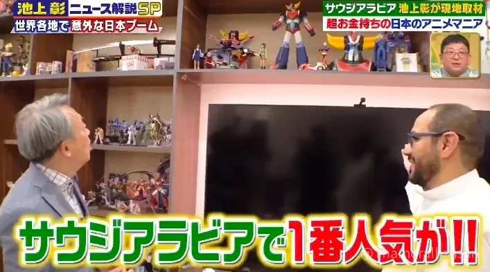
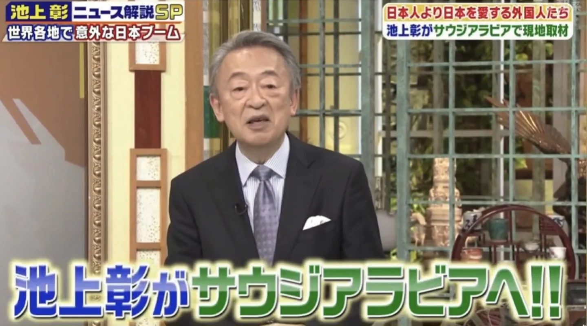

<figure class="post-figure"><figcaption>التعريف بالمقتنيات في المنزل بالرياض (من برنامج TV Asahi)</figcaption></figure>

من أكثر التجارب التي لا أنساها استقبالي في منزلي بـ**الرياض** للأستاذ **Ikegami Akira** (池上彰)، أحد أبرز الصحفيين والإعلاميين في **اليابان**.

كان الأستاذ Ikegami في زيارة للمملكة لإعداد تقرير لبرنامج «**池上彰ニュース解説SP**» على قناة **TV Asahi**، في حلقة عن انتشار الثقافة اليابانية حول العالم، وكان التقرير عن **السعودية** الحديثة ومجتمعها، وعن حياة الناس فيها وعلاقتها باليابان. وكانت الزيارة فرصة نادرة لأشارك رؤيتي الشخصية عن الحياة في السعودية، وعن الصلة الثقافية الممتدة بين البلدين.

<figure class="post-figure"><figcaption>من برنامج «池上彰ニュース解説SP» على TV Asahi</figcaption></figure>

لم تكن الزيارة بالنسبة لي مجرد لقاء تلفزيوني، بل فرصة للحديث مباشرة عن ثقافة أحببتها منذ سنوات طويلة، وكيف أصبحت جزءًا من الحياة اليومية لأجيال من السعوديين.

## من النفط والسيارات إلى الأنمي والميكا والسوبر روبوت

تطورت العلاقة بين السعودية واليابان على مدى عقود طويلة، وامتدت إلى مجالات كثيرة.

من النفط والسيارات، إلى الأجهزة المنزلية والإلكترونيات وألعاب الفيديو والأنمي، كانت المنتجات والثقافة اليابانية حاضرة في حياة المجتمع السعودي منذ زمن بعيد.

وأثمن قطعة عرضتها على الأستاذ Ikegami لم تكن مجسم روبوت، بل مجسم لأول بئر نفط في السعودية، في داخله كمية صغيرة من النفط، أهدته لي **أرامكو السعودية** تكريمًا. فأكثر ما يعرفه اليابانيون عن السعودية أنها بلد النفط، فأحببت أن تبدأ قصتنا من هناك.

<blockquote class="instagram-media" data-instgrm-permalink="https://www.instagram.com/p/C1fOoryItgd/" data-instgrm-version="14" style="max-width:540px;width:100%;margin:24px auto"><a href="https://www.instagram.com/p/C1fOoryItgd/" target="_blank" rel="noopener">شاهد المنشور على Instagram</a></blockquote>

ومن أعمق جوانب هذه الصلة الثقافية **الأنمي** الياباني. وفي مقدمته مسلسل **UFO Robot Grendizer**، الذي كان من أوائل أعمال الأنمي اليابانية التي عرفها الجمهور السعودي على نطاق واسع عبر التلفزيون. وما زال عند كثيرين أكثر من مجرد مسلسل كرتوني؛ فهو ذكرى طفولة عزيزة، ورمز ثقافي تتناقله الأجيال.

ولهذا أرى أن الأنمي وأعمال الميكا والسوبر روبوت اليابانية لم تبقَ في حدود الترفيه، بل صنعت صلة ثقافية مألوفة بين الناس في السعودية واليابان.

## كيف جمع الأنمي الياباني بين الأجيال

بالنسبة لكثيرين منا ممن كبروا على الأنمي الياباني، كانت مشاهدته في الغالب تجربة اجتماعية مشتركة.

كانت العائلة والأصدقاء يجتمعون أمام التلفزيون، ويستمتع الكبار والصغار بالأعمال نفسها. ومع الوقت أصبح الأنمي الياباني جزءًا طبيعيًا من الحياة اليومية ومن ذكريات الطفولة في السعودية.

واليوم يشهد عالم الأنمي والألعاب في المملكة تحولًا كبيرًا.

فبقيادة صاحب السمو الملكي الأمير محمد بن سلمان ولي العهد، تعمل السعودية على تطوير قطاعات الترفيه والألعاب والرسوم المتحركة ضمن **رؤية 2030**. ومن ذلك الاستراتيجية الوطنية للألعاب والرياضات الإلكترونية، و**مجموعة سافي للألعاب** (Savvy Games Group)، و**مانجا للإنتاج** التابعة لمؤسسة محمد بن سلمان (مسك).

وهنا رحلة لافتة: من أجيال كبرت على مشاهدة الأنمي الياباني في التلفزيون، إلى جيل جديد يهتم بصناعة المحتوى والألعاب، وبالتعاون الدولي مع اليابان وغيرها.

## منزل مليء بالذكريات

خلال الزيارة أتيحت لي فرصة تعريف الأستاذ Ikegami بمقتنياتي الشخصية.

في منزلي مجسمات ونماذج مستوحاة من أعمال يابانية أعتز بها منذ سنوات، منها **Grendizer** و**Mazinger** و**Ashita no Joe**.

كل قطعة منها تمثل أكثر من شخصية أو مسلسل؛ فهي تحمل ذكرياتي، وتحمل معها أيضًا ذكريات أجيال من المعجبين السعوديين الذين كبروا مع الأنمي الياباني وأحبوا شخصياته وقصصه.

وأثناء تعريفه بالمقتنيات، أردت أن أشاركه ليس الأعمال نفسها فقط، بل كيف أصبحت جزءًا من حياتنا، وكيف احتضنها الجمهور السعودي بهذا العمق.

## من Gundam إلى عالم النماذج التركيبية

ومن المواضيع التي عرّفته بها أيضًا إحدى هواياتي الشخصية: النماذج التركيبية، وخصوصًا **Gunpla**، وهي نماذج تركيبية مستوحاة من عالم **Gundam**.

عرضت على الأستاذ Ikegami عددًا من مجسمات Gundam، وشرحت له ما يجذب الناس إلى هذه الهواية التي لها مجتمع واسع من الهواة حول العالم.

كما عرّفته ببعض الكتب والمجلات اليابانية المتخصصة التي أحتفظ بها مرجعًا، وفيها الكثير عن تقنيات التركيب والتلوين والتعديل، وأعمال المحترفين والهواة.

فتركيب النموذج أكبر بكثير من مجرد جمع قطع بلاستيكية؛ إنه عملية إبداعية تشمل القص والتشكيل والتلوين والتعديل، ويطوّر فيها كل هاوٍ مجسمه بطريقته الخاصة.

ومن خلال Gunpla، كنت أتمنى أن أقدّم له لمحة عن عمق هواية تركيب النماذج وتنوعها.

## نماذج AOSHIMA: مشاهد من الحياة اليومية في اليابان

ومن النماذج الأخرى التي شاهدها الأستاذ Ikegami مجموعة من نماذج شركة **AOSHIMA** اليابانية، وخصوصًا سلسلة **Moving Store** (移動販売!) بمقياس 1/24.

تقدّم هذه السلسلة نماذج مصغّرة لعربات البيع المتنقلة في اليابان، بتصاميم متنوعة مستوحاة من مشاهد الحياة اليومية.

وكان في مجموعتي عدد منها، مثل شاحنة مزيّنة بزخارف احتفالية، وعربة لبيع الرامن، وأخرى لبيع السوشي، وغيرها.

<blockquote class="instagram-media" data-instgrm-permalink="https://www.instagram.com/p/C1knFGgIb1N/" data-instgrm-version="14" style="max-width:540px;width:100%;margin:24px auto"><a href="https://www.instagram.com/p/C1knFGgIb1N/" target="_blank" rel="noopener">شاهد المنشور على Instagram</a></blockquote>

وما يميّز هذه النماذج أنها لا تكتفي بإعادة تصميم المركبات، بل تلتقط تفاصيل مألوفة من الحياة اليومية في اليابان وتحوّلها إلى مشاهد مصغّرة مصنوعة بعناية. وهي تعكس تقديرًا للحظات العادية، ورغبة في حفظها عبر فن صناعة النماذج.

وكان له معنى خاص عندي أن تصبح نماذج تصوّر مشاهد مألوفة من شوارع اليابان جزءًا من منزل هاوٍ في السعودية. فهذا في نظري وجه مهم من وجوه التبادل الثقافي في الاتجاهين؛ فكما وصلت الثقافة والهوايات اليابانية إلى بيوتنا، يمكن للهواة في اليابان أن يتعرّفوا على الطريقة التي يقدّرها بها الناس في السعودية ويستمتعون بها.

وجاءت لاحقًا صلة لم أتوقعها؛ فبعد نحو عام من هذه الزيارة، أتيحت لي فرصة لقاء رئيس شركة AOSHIMA، وذكر لي خلال اللقاء أنه شاهد الصورة التي التُقطت أثناء زيارة الأستاذ Ikegami لمنزلي.

<blockquote class="instagram-media" data-instgrm-permalink="https://www.instagram.com/p/DJ-YeqmzZHp/" data-instgrm-version="14" style="max-width:540px;width:100%;margin:24px auto"><a href="https://www.instagram.com/p/DJ-YeqmzZHp/" target="_blank" rel="noopener">شاهد المنشور على Instagram</a></blockquote>

كانت مصادفة جميلة ربطت ذلك اليوم المميز بلقاء لاحق مع أحد الأسماء البارزة في صناعة النماذج التركيبية في اليابان.

## ساعات من الحديث والضيافة

من التفاصيل التي ما زلت أتذكرها بوضوح، الساعات الطويلة التي قضاها الأستاذ Ikegami في منزلي.

كان يتأمل المقتنيات والنماذج واحدة واحدة، ويستمع إلى شرحي، ويبدي اهتمامًا حقيقيًا بكل موضوع تحدثنا عنه.

<blockquote class="instagram-media" data-instgrm-permalink="https://www.instagram.com/p/C0d-AhDoxgN/" data-instgrm-version="14" style="max-width:540px;width:100%;margin:24px auto"><a href="https://www.instagram.com/p/C0d-AhDoxgN/" target="_blank" rel="noopener">شاهد المنشور على Instagram</a></blockquote>

وما لفت انتباهي دقته واهتمامه بالتفاصيل، ورغبته في فهم جوانب مختلفة من المجتمع السعودي وعلاقته بالثقافة اليابانية. لم تكن الزيارة توقفًا قصيرًا من أجل لقاء تلفزيوني، بل كانت فرصة لتبادل حقيقي.

كما عبّر فريق التصوير عن تقديره لهذه التجربة، وكان لذلك أثر كبير في نفسي.

وأتمنى صادقًا أن نكون قد وُفّقنا في إشعاره بالترحيب، وفي تقديم الضيافة والتقدير اللائقين بضيف بهذه المكانة.

## ما بعد الزيارة: صلة ثقافية لم نتوقعها

لم تنتهِ القصة بانتهاء الزيارة.

فقد تحدث الأستاذ Ikegami لاحقًا عن لقائنا في كتابه «[**20歳の自分に教えたいイスラム世界**](https://amzn.asia/d/07IAjU2L){:target="_blank" rel="noopener"}» (العالم الإسلامي الذي تمنيت أن أعرفه في العشرين). ويضم الكتاب فصلًا عن السعودية، خصّص فيه نحو ثلاث صفحات للحديث عن زيارته لمنزلي.

وكان شرفًا كبيرًا لي أن تصبح تجربة شخصية جزءًا من كتاب منشور يصل إلى القراء في اليابان.

وبعد عرض البرنامج على TV Asahi، شاهده كثيرون في اليابان، حتى إن بعض المشاهدين سجّلوه واحتفظوا بنسخة منه.

وبعد البرنامج بدأت تصلني رسائل من يابانيين يرغبون في معرفة المزيد عن المجتمع السعودي وثقافته المحلية والحياة اليومية في المملكة.

لم تكن هذه الصلات بدافع تجاري، بل نشأت بشكل طبيعي من فضول مشترك ورغبة صادقة في أن يفهم كلٌّ منا الآخر. وبعض هذه الأحاديث مستمر إلى اليوم.

## حين تصبح الهواية لغة مشتركة

حين أستعيد هذه التجربة، أتذكر أمرًا مهمًا.

عندما نفكر في التبادل الثقافي، يخطر لنا غالبًا العمل الدبلوماسي أو الفعاليات الكبرى أو التعاون بين المؤسسات. لكن الصلات العميقة يمكن أن تبدأ بطرق أبسط بكثير.

مجسم روبوت معروض في المنزل، أو مسلسل أنمي مفضّل، أو اهتمام مشترك بتركيب النماذج، قد يكون بداية حديث يتجاوز الحدود ويقرّب بين الناس.

وهذه أيضًا من الأفكار التي أتمنى أن أنشرها من خلال **Saudi Mecha Robot**.

فعالم النماذج التركيبية والميكا والسوبر روبوت لا يقتصر على الاستمتاع بالشخصيات الخيالية أو تركيب المجسمات، بل يمكن أن يشجّع على الإبداع، والتعلّم التقني، وتبادل المعرفة، وبناء صلات حقيقية بين أناس من خلفيات ثقافية مختلفة.

## من الرياض إلى اليابان: جسور يبنيها الشغف

حين أنظر إلى تلك الزيارة، أشعر بالامتنان لأن الميكا والسوبر روبوت والنماذج التركيبية أصبحت جسرًا بين ثقافتين.

ضيف ياباني يزور منزلًا في الرياض، ويكتشف مجموعة من مجسمات الأنمي والنماذج اليابانية، ويقضي ساعات في الحديث عن القصص والهوايات التي تقف خلفها. ثم يصل هذا اللقاء إلى الجمهور في اليابان عبر التلفزيون وكتاب منشور، ويفتح الباب لمزيد من الأحاديث والصلات.

ولعل هذا من أجمل ما في الهواية المشتركة.

فلا نحتاج دائمًا إلى أن نتحدث اللغة نفسها، أو أن نأتي من الخلفية نفسها، لكي نتواصل. أحيانًا يكفي مجسم Gundam واحد، أو عربة بيع يابانية صغيرة، لتبدأ قصة تقرّب بين ثقافتين.

