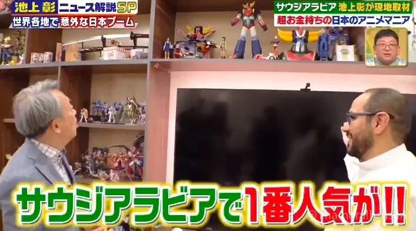
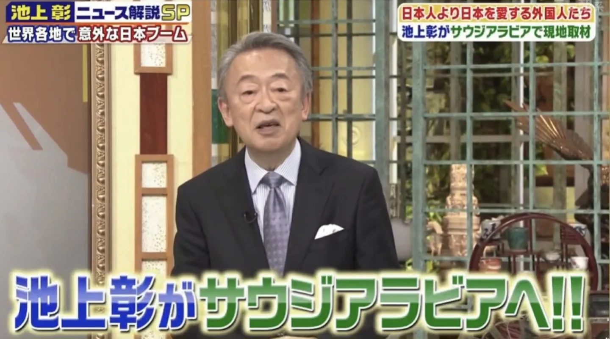

<figure class="post-figure"><figcaption>Showing the collection at home in Riyadh (from the TV Asahi programme)</figcaption></figure>

One of the most memorable experiences I have had was welcoming **Akira Ikegami** (池上彰), one of Japan's most prominent journalists and television personalities, into my home in **Riyadh**, **Saudi Arabia**.

Mr. Ikegami was visiting the Kingdom to film a report for **TV Asahi**'s ***Ikegami Akira News Kaisetsu SP*** (池上彰ニュース解説SP), in an episode about surprising Japan booms around the world, focusing on modern Saudi Arabia and its society. The visit gave me a unique opportunity to share my personal perspective on Saudi life and the longstanding cultural connection between Saudi Arabia and Japan.

<figure class="post-figure"><figcaption>From TV Asahi's Ikegami Akira News Kaisetsu SP</figcaption></figure>

For me, this was more than just a television interview. It was an opportunity to talk about a culture I have admired for many years and how it has become part of everyday life for generations of Saudis.

## From Oil and Automobiles to Anime, Mecha and Super Robots

The relationship between Saudi Arabia and Japan has developed over many decades, spanning a wide range of fields.

From oil and automobiles to electronics, video games, and anime, Japanese products and culture have long been familiar to Saudi society.

The most treasured piece I showed Mr. Ikegami was not a robot at all, but a model of Saudi Arabia's first oil well, containing a small amount of oil, presented to me by **Saudi Aramco** in recognition. Oil is what Japan knows best about Saudi Arabia, so it felt right to begin our story there.

<blockquote class="instagram-media" data-instgrm-permalink="https://www.instagram.com/p/C1fOoryItgd/" data-instgrm-version="14" style="max-width:540px;width:100%;margin:24px auto"><a href="https://www.instagram.com/p/C1fOoryItgd/" target="_blank" rel="noopener">View this post on Instagram</a></blockquote>

Among the most influential aspects of this cultural connection is Japanese animation. In particular, **UFO Robot Grendizer** was one of the early Japanese anime series to become widely known among Saudi audiences through television broadcasts. For many people, it remains much more than an animated series: it is a cherished childhood memory and a cultural icon shared across generations.

Japanese anime, mecha and super robot series have therefore become more than entertainment. They have helped create a familiar cultural connection between people in Saudi Arabia and Japan.

## How Japanese Anime Connected Generations

For many of us who grew up watching Japanese anime, it was often a shared social experience.

Families and friends would gather around the television, enjoying the same shows across different generations. Over time, Japanese animation became a natural part of everyday life and childhood memories in Saudi Arabia.

Today, the landscape surrounding anime and gaming in the Kingdom is evolving significantly.

Under the leadership of Crown Prince Mohammed bin Salman, Saudi Arabia has been developing its entertainment, gaming, and animation sectors as part of **Vision 2030**. Initiatives such as the National Gaming and Esports Strategy, **Savvy Games Group**, and **Manga Productions**, a subsidiary of the Mohammed bin Salman Foundation (MiSK), reflect this growing ambition.

There is an interesting journey here: from generations who grew up watching Japanese anime on television to a new generation exploring content creation, gaming, and international collaboration with Japan and other countries.

## A Home Filled with Memories

During the visit, I had the opportunity to introduce Mr. Ikegami to my personal collection.

My home includes figures and models inspired by some of the Japanese works I have cherished over the years, including **Grendizer**, **Mazinger**, and **Ashita no Joe**.

Each piece represents more than a character or a series. These collections also reflect the memories of generations of Saudi fans who grew up with Japanese animation and developed a lasting appreciation for its characters and stories.

As I introduced the collection, I wanted to share not only the works themselves, but also how they became part of our lives and how deeply they have been embraced by Saudi audiences.

## From Gundam to the World of Model Kits

Another subject I introduced was one of my personal hobbies: plastic model kits, particularly **Gunpla**, the plastic model kits based on the Gundam universe.

I showed Mr. Ikegami several Gundam models and explained the appeal of this hobby, which has a dedicated community of enthusiasts around the world.

I also shared some of the Japanese specialist books and magazines I keep as references. They feature a wealth of material on building techniques, painting, customization, and the work of both professional and amateur modelers.

Building a model kit is about much more than assembling plastic parts. It is a creative process that can involve cutting, shaping, painting, and customizing, allowing each builder to develop a model in their own way.

Through Gunpla, I hoped to give him a glimpse into the depth and diversity of the model-building hobby.

## AOSHIMA Models: Everyday Scenes from Japan

Among the other models Mr. Ikegami saw was a collection of Japanese plastic model kits by **AOSHIMA**, particularly its 1/24 **Moving Store** (移動販売!) series.

The series features miniature models of Japanese mobile vendors, with a variety of designs inspired by everyday scenes.

My collection included several different examples, such as a truck with festive decorations, a ramen vendor truck, and a sushi vendor truck, among others.

<blockquote class="instagram-media" data-instgrm-permalink="https://www.instagram.com/p/C1knFGgIb1N/" data-instgrm-version="14" style="max-width:540px;width:100%;margin:24px auto"><a href="https://www.instagram.com/p/C1knFGgIb1N/" target="_blank" rel="noopener">View this post on Instagram</a></blockquote>

What makes these models particularly interesting is that they go beyond simply reproducing vehicles. They capture familiar details of everyday Japanese life and turn them into carefully crafted miniature scenes. They reflect an appreciation for ordinary moments and the desire to preserve them through the art of model making.

I found it particularly meaningful that models depicting familiar scenes from Japanese streets had become part of a collector's home in Saudi Arabia. To me, this represents an important aspect of cultural exchange in both directions. Just as Japanese culture and hobbies have found their way into our homes, enthusiasts in Japan can also discover how people in Saudi Arabia appreciate and engage with them.

There was also an unexpected connection that came later. About a year after this visit, I had the opportunity to meet the president of AOSHIMA. During our meeting, he mentioned that he had seen the photograph taken during Mr. Ikegami's visit.

<blockquote class="instagram-media" data-instgrm-permalink="https://www.instagram.com/p/DJ-YeqmzZHp/" data-instgrm-version="14" style="max-width:540px;width:100%;margin:24px auto"><a href="https://www.instagram.com/p/DJ-YeqmzZHp/" target="_blank" rel="noopener">View this post on Instagram</a></blockquote>

It was a pleasant coincidence, connecting that memorable day with a later encounter with one of the notable names in the Japanese model-kit industry.

## Hours of Conversation and Hospitality

One detail I still remember clearly is how many hours Mr. Ikegami spent at my home.

He took his time looking through the collection and models, listening to my explanations and showing genuine interest in the different subjects we discussed.

<blockquote class="instagram-media" data-instgrm-permalink="https://www.instagram.com/p/C0d-AhDoxgN/" data-instgrm-version="14" style="max-width:540px;width:100%;margin:24px auto"><a href="https://www.instagram.com/p/C0d-AhDoxgN/" target="_blank" rel="noopener">View this post on Instagram</a></blockquote>

What stood out to me was his attention to detail and his willingness to learn about different aspects of Saudi society and its relationship with Japanese culture. It was not simply a brief stop for a television interview; it was an opportunity for a genuine exchange.

The filming crew also expressed their appreciation for the experience, which meant a great deal to me.

I sincerely hope we succeeded in making him feel welcome and in offering the hospitality and respect befitting such an esteemed guest.

## Beyond the Visit: An Unexpected Cultural Connection

The story did not end with that visit.

Mr. Ikegami later referred to our meeting in his book, [***20歳の自分に教えたいイスラム世界***](https://amzn.asia/d/07IAjU2L){:target="_blank" rel="noopener"} (*The Islamic World I Wish I Had Known at Twenty*). The book includes a section dedicated to Saudi Arabia, with approximately three pages discussing his visit to my home.

It was a great honour to see a personal experience become part of a published work that would reach readers in Japan.

After the programme aired on TV Asahi, it was watched by many people in Japan. Some viewers even recorded and kept a copy of the broadcast.

Following the programme, I began hearing from Japanese people who were interested in learning more about Saudi society, local culture, and everyday life in the Kingdom.

These connections were not driven by commercial interests. They grew naturally from a shared curiosity and a genuine desire to understand one another. Some of these conversations have continued to this day.

## When a Hobby Becomes a Common Language

Looking back on this experience, I was reminded of something important.

When we think of cultural exchange, we often imagine diplomacy, major events, or cooperation between institutions. But meaningful connections can also begin in much simpler ways.

A robot figure displayed at home, a favourite anime series, or a shared interest in model building can become the starting point for a conversation that crosses borders and brings people together.

This is also one of the ideas I hope to promote through **Saudi Mecha Robot**.

The world of plastic model kits, mecha, and super robots is not just about enjoying fictional characters or assembling models. It can also encourage creativity, technical learning, the exchange of knowledge, and meaningful connections between people from different cultural backgrounds.

## From Riyadh to Japan: Building Bridges Through Passion

When I look back on that visit, I feel grateful that mecha, super robots and model kits became a bridge between two cultures.

A Japanese guest visiting a home in Riyadh, discovering a collection of Japanese anime figures and model kits, and spending hours discussing the stories and hobbies behind them. That encounter later reached audiences in Japan through television and a published book, opening the door to further conversations and connections.

Perhaps this is one of the most beautiful things about a shared hobby.

We do not always need to speak the same language or come from the same background to connect with one another. Sometimes, a Gundam model or a small Japanese mobile vendor truck can be enough to begin a story that brings two cultures closer together.

