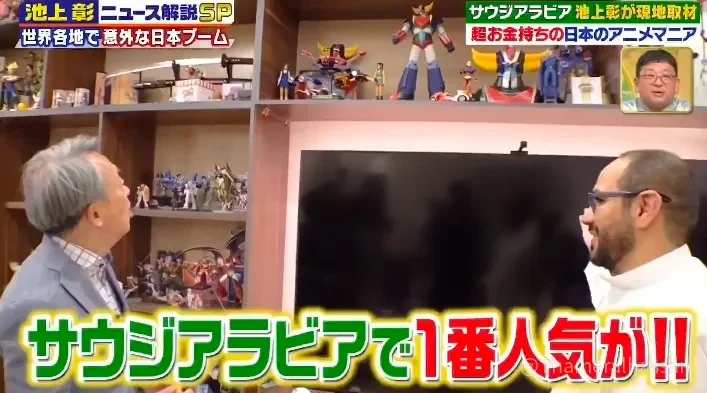
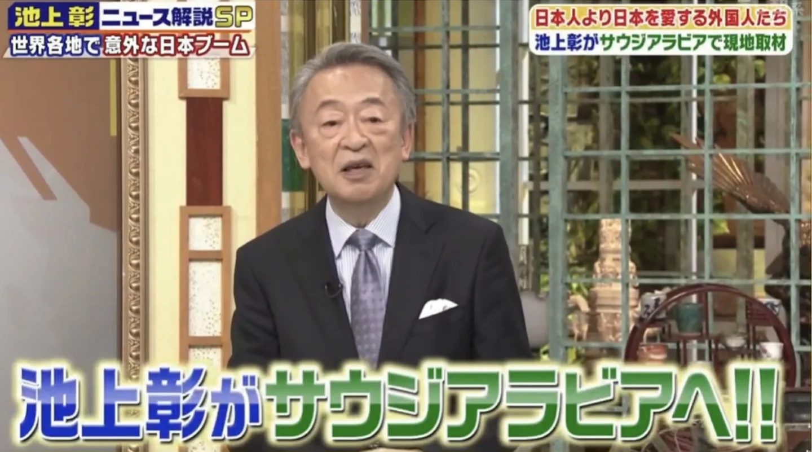

<figure class="post-figure"><figcaption>リヤドの自宅でコレクションを紹介（テレビ朝日の番組より）</figcaption></figure>

私にとって忘れられない出来事の一つに、日本を代表するジャーナリスト・**池上彰**さん（Ikegami Akira）を、**サウジアラビア**の**リヤド**にある自宅にお迎えしたことがあります。

池上さんは、現代のサウジアラビアを紹介するテレビ番組の取材のために来訪されていました。番組は**テレビ朝日**（TV Asahi）の『**池上彰ニュース解説SP**』で、「世界各地で意外な日本ブーム」をテーマに、サウジアラビアの社会や人々の暮らし、そして日本とのつながりを伝えるものでした。

<figure class="post-figure"><figcaption>テレビ朝日『池上彰ニュース解説SP』より</figcaption></figure>

私にとって、この訪問は単なるテレビ取材ではありませんでした。長年親しんできた日本の文化と、自分が暮らすサウジアラビアの社会について、直接お話しできる貴重な機会だったのです。

## 石油や自動車から、アニメやスーパーロボットへ

サウジアラビアと日本の交流は、長い年月をかけてさまざまな分野に広がってきました。

石油をはじめ、自動車や家電、電子機器、そしてビデオゲームまで。日本の製品や文化は、長いあいだサウジアラビアの人々の暮らしに身近なものでした。

池上さんにお見せした中で、私にとって最も大切な一品はロボットではありませんでした。**サウジアラムコ**から記念として贈られた、サウジアラビア初の油井を再現した模型です。中には少量の原油が入っています。日本で最もよく知られているサウジアラビアの姿は「石油の国」。だからこそ、私たちの話をそこから始めたいと思ったのです。

<blockquote class="instagram-media" data-instgrm-permalink="https://www.instagram.com/p/C1fOoryItgd/" data-instgrm-version="14" style="max-width:540px;width:100%;margin:24px auto"><a href="https://www.instagram.com/p/C1fOoryItgd/" target="_blank" rel="noopener">Instagramで見る</a></blockquote>

その中でも、**アニメ**は世代を超えて多くの人々に親しまれてきた文化の一つです。

特に『**UFOロボ グレンダイザー**』は、サウジアラビアでテレビ放送を通じて広く知られるようになった日本アニメの代表的な作品です。今でも多くの人々にとって、子どもの頃の思い出と結びついた特別な存在であり、世代を超えて語り継がれる作品となっています。

こうした日本のアニメやスーパーロボット作品は、単なる娯楽にとどまらず、サウジアラビアの人々と日本を結ぶ文化的な接点の一つになってきたと感じています。

## 日本のアニメがつないだ世代と世代

私たちの世代にとって、日本のアニメを見ることは、時に家族や友人が一緒に過ごす時間でもありました。

テレビの前に集まり、世代の異なる家族や友人と同じ作品を楽しむ。そうした経験を通じて、日本のアニメは多くの人々の日常の中に自然と溶け込んでいきました。

そして現在、サウジアラビアではアニメやゲームを取り巻く環境が大きく変化しています。

ムハンマド・ビン・サルマン皇太子のリーダーシップのもと、サウジアラビアでは「**ビジョン2030**」に沿って、エンターテインメント、ゲーム、アニメーションなどの分野の発展が進められています。国家ゲーム・eスポーツ戦略や、**Savvy Games Group**、さらにムハンマド・ビン・サルマン財団（MiSK）傘下の**マンガ・プロダクションズ**など、さまざまな取り組みが生まれています。

かつて日本のアニメをテレビで楽しんでいた世代から、今ではコンテンツ産業の発展や日本との新たな協力に関心を持つ世代へ。こうした変化も、サウジアラビアと日本の文化交流の新しい一面だと思います。

## 一つの家に広がる、世代の記憶

池上さんに私のコレクションを紹介する時間もありました。

自宅には、『**グレンダイザー**』や『**マジンガー**』、そして『**あしたのジョー**』など、私が長年大切にしてきた作品に関するフィギュアや模型を飾っています。

それぞれの作品には、私自身の思い出だけでなく、日本のアニメや文化に親しんできたサウジアラビアの世代の記憶も重なっています。

一つひとつのコレクションについてお話しすることで、作品そのものだけでなく、それがサウジアラビアの人々にどのように受け入れられ、親しまれてきたのかもお伝えできたのではないかと思います。

## ガンプラから広がる模型の世界

今回の訪問では、私が趣味としているプラモデル、特に**ガンプラ**（ガンダムのプラモデル）についても紹介しました。

池上さんには、いくつかのガンプラ作品をご覧いただきながら、プラモデルという趣味の魅力や、その楽しみ方についてお話ししました。

また、自宅に保管している日本の模型専門誌や書籍も紹介しました。そこには、組み立てや塗装、改造の技法をはじめ、プロのモデラーやアマチュアの愛好家による作品など、模型づくりに関するさまざまな情報が掲載されています。

プラモデルは、箱を開けて組み立てるだけのものではありません。パーツを切り出し、形を整え、塗装や加工を施しながら、自分だけの作品を作り上げていく奥深い趣味です。

ガンプラをきっかけに、模型づくりの世界には多様な楽しみ方があることを知っていただけたのではないかと思います。

## AOSHIMAの模型に見る、日本の日常風景

池上さんがご覧になったものの中には、日本の模型メーカー**AOSHIMA**によるプラモデルもありました。

特に、1/24スケールの「**Moving Store（移動販売!）**」シリーズです。このシリーズは、日本の移動販売車を題材にした模型で、さまざまなデザインや細かなディテールが再現されています。

コレクションには、華やかな装飾が施されたトラック、ラーメンの移動販売車、寿司の販売車など、いくつかの異なるモデルがありました。

<blockquote class="instagram-media" data-instgrm-permalink="https://www.instagram.com/p/C1knFGgIb1N/" data-instgrm-version="14" style="max-width:540px;width:100%;margin:24px auto"><a href="https://www.instagram.com/p/C1knFGgIb1N/" target="_blank" rel="noopener">Instagramで見る</a></blockquote>

これらの模型は、ただ乗り物を再現するだけのものではありません。日本の街角で見られる身近な風景や日常の営みを、細部にまでこだわって模型として表現しています。日常の何気ない風景にまで目を向け、それを模型という形で残そうとする、日本のものづくり文化の一面を感じさせてくれます。

日本の街で見られる風景を再現した模型が、サウジアラビアに暮らす一人の愛好家のコレクションに加わっている。そのこと自体が、文化交流の双方向性を表しているように感じました。

日本の文化や趣味が私たちの暮らしに届いているように、サウジアラビアの愛好家がそれらをどのように楽しみ、大切にしているのかを、日本の人々にも知っていただける機会があるのだと思います。

さらに興味深いことに、この訪問からおよそ1年後、私はAOSHIMAの社長とお会いする機会がありました。その際、池上さんが自宅を訪問されたときに撮影された写真をご覧になったと聞きました。

<blockquote class="instagram-media" data-instgrm-permalink="https://www.instagram.com/p/DJ-YeqmzZHp/" data-instgrm-version="14" style="max-width:540px;width:100%;margin:24px auto"><a href="https://www.instagram.com/p/DJ-YeqmzZHp/" target="_blank" rel="noopener">Instagramで見る</a></blockquote>

日本の模型メーカーの方との後日の出会いが、あの訪問の思い出とつながったことは、私にとってうれしい偶然でした。

## 長い時間をかけて生まれた交流

今でも印象に残っているのは、池上さんが訪問中、何時間にもわたって自宅で過ごされたことです。

コレクションや模型を一つひとつご覧になり、私の話に耳を傾けながら、さまざまなことに関心を示してくださいました。

<blockquote class="instagram-media" data-instgrm-permalink="https://www.instagram.com/p/C0d-AhDoxgN/" data-instgrm-version="14" style="max-width:540px;width:100%;margin:24px auto"><a href="https://www.instagram.com/p/C0d-AhDoxgN/" target="_blank" rel="noopener">Instagramで見る</a></blockquote>

サウジアラビアの社会や日本文化との関わりについて、直接話を聞き、理解しようとされる姿がとても印象的でした。テレビ番組の取材のために短時間立ち寄るというだけではなく、時間をかけてさまざまなことを知ろうとしてくださったことを、今でもよく覚えています。

また、撮影スタッフの皆さんからも、この訪問について好意的な感想をいただきました。

大切なゲストとしてお迎えした池上さんに、少しでも心地よく過ごしていただき、私なりの精一杯のおもてなしができていたなら、これほどうれしいことはありません。

## 訪問のその後――思いがけず続いた文化交流

この訪問は、その日の出来事だけで終わったわけではありませんでした。

池上さんは後に、著書『[**20歳の自分に教えたいイスラム世界**](https://amzn.asia/d/07IAjU2L){:target="_blank" rel="noopener"}』の中で、私との出会いについても触れてくださいました。同書ではサウジアラビアについて一つの章が設けられており、その中で今回の訪問についても約3ページにわたって紹介されています。

自宅での何気ない交流が、日本で出版された本の中に記録され、多くの読者の目に触れることになったのは、私にとって大変うれしく、光栄なことでした。

また、テレビ朝日で番組が放送された後、日本の多くの方々が番組をご覧になりました。放送を録画して大切に保存してくださった方もいたそうです。

その後、サウジアラビアの社会や文化についてもっと知りたいという日本の方々から連絡をいただくようになりました。

こうした交流は、何か商業的な目的があって始まったものではありません。互いの国や文化に関心を持ち、知りたいことを尋ね、経験を共有する。そんな自然なやり取りが、今も続いています。

## 趣味が共通の言葉になるとき

今回の訪問を通じて、改めて感じたことがあります。

文化交流というと、外交や大きなイベント、組織同士の協力などを思い浮かべるかもしれません。しかし、実際にはもっと身近なところから始まることもあります。

自宅に飾ってある一体のロボット、好きなアニメ作品、模型づくりという趣味。そうした小さなきっかけが、国や言葉の違いを越えて、人と人をつなぐことがあります。

**Saudi Mecha Robot**という活動を通じて、私が大切にしたいと考えているのも、まさにそうしたつながりです。

プラモデルやメカ、スーパーロボットに関する文化は、作品を楽しむだけでなく、ものづくりへの関心を深めたり、技術や知識を共有したり、異なる文化を持つ人々が交流したりするための共通の入り口にもなります。

## リヤドから日本へ――趣味がつくる架け橋

あの訪問を振り返ると、メカやスーパーロボット、模型が文化をつなぐ架け橋になったことを、改めてうれしく思います。

サウジアラビアの自宅に並ぶ日本のアニメ作品や模型を通じて、日本から来られた方と何時間も語り合う。そして、その出会いがテレビ番組や書籍を通じて日本の人々にも伝わり、新たな交流へとつながっていく。

これこそ、趣味が持つ力の一つなのかもしれません。

同じ言葉を話す必要も、同じ背景を持つ必要もありません。一つのガンダム、一台の小さな日本の移動販売車。それが、二つの文化をつなぐ物語の始まりになることがあります。

こうした小さな交流が、これからも続いていけばと思っています。

